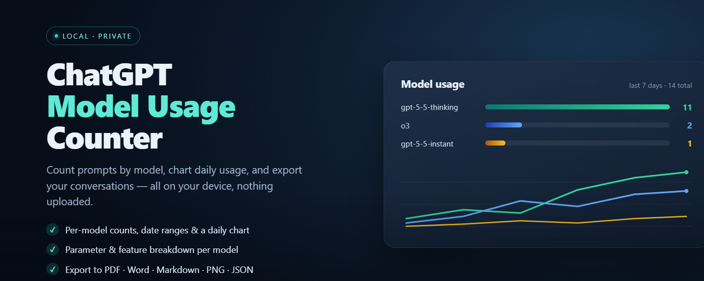
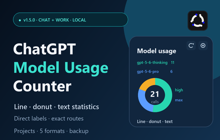
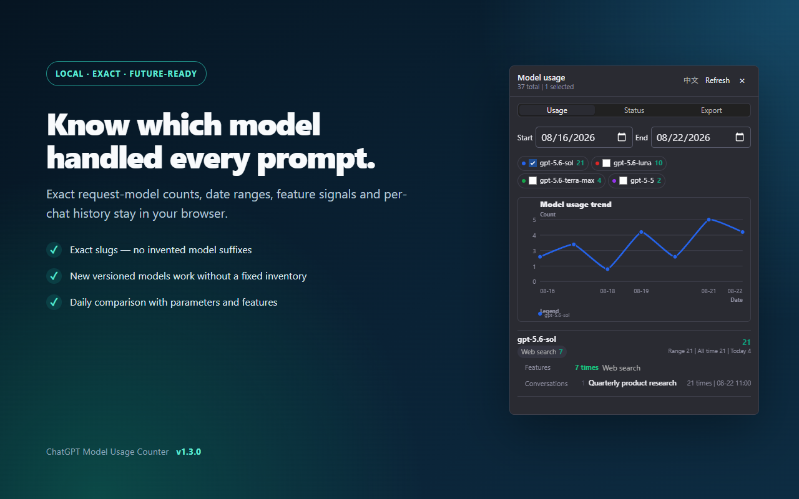
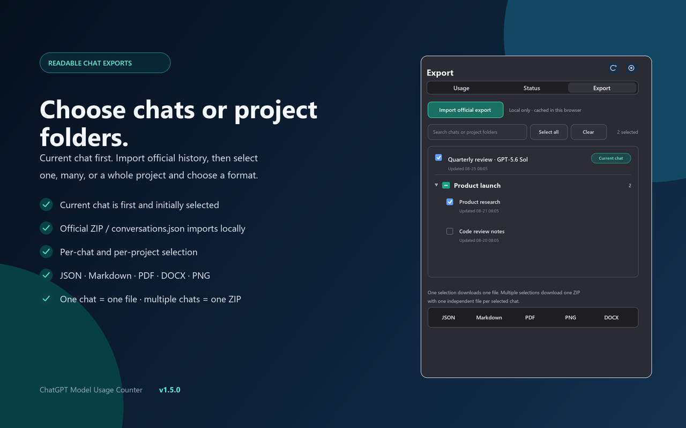
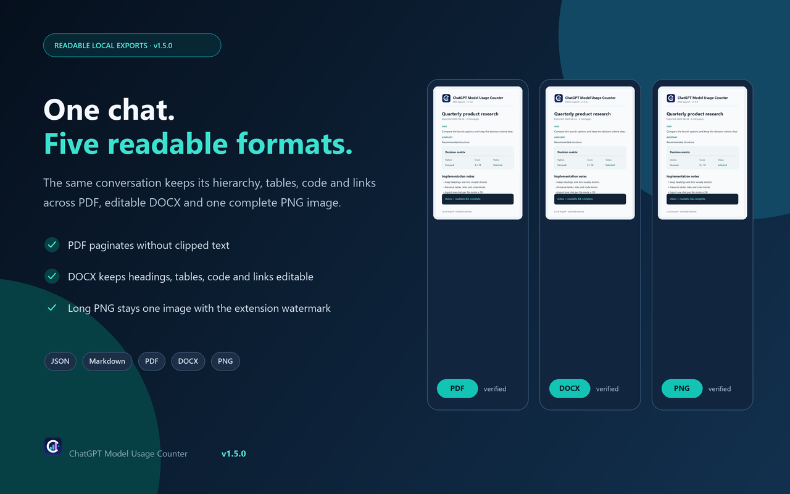

<div align="center">

# ChatGPT Model Usage Counter



**在浏览器本地统计 ChatGPT 的模型使用，并从当前登录账号的对话列表中逐项选择导出。**

**Track ChatGPT model usage locally and export explicitly selected conversations from the signed-in account list.**

[中文说明](#-中文) · [English](#-english) · [下载 / Download](https://github.com/Bsnblanc/chatgpt-model-usage-counter/releases)



</div>

> Manifest V3 Chrome extension · UI language follows ChatGPT by default · No publisher server · MIT

---

## 界面与导出预览 / Interface and export preview

<p align="center">
  
  
</p>

<p align="center">
  
</p>

<a id="-中文"></a>

## 🇨🇳 中文

扩展在当前 Chrome 配置中本地记录 ChatGPT 网页的提交次数、模型关系和相关功能。它不是 OpenAI 官方账单、额度、速率限制或 token 统计。

### 当前功能

| 功能 | 实际行为 |
|---|---|
| **自动语言** | 默认跟随 ChatGPT 网页语言；无法读取时跟随浏览器语言，也可在设置中固定为 English 或中文；两个入口共享选择 |
| **Chat / Work** | Chat 和 Work 共用同一条统计事件链，可按“全部 / Chat / Work”筛选 |
| **一次提交只计一次** | 提交时建立事件；请求型号和最终回复型号随后更新到同一事件，最终回复不会增加第二次计数 |
| **Basic（映射）** | 按当前账号模型目录解析后的公开模型汇总；新型号无法映射时保留精确内部 slug，不猜测旧名称 |
| **Advanced（内部）** | 以请求型号为一级、实际回复型号为二级展示；思考强度跟随对应回复型号，请求和回复缺失时分别显示“未知” |
| **折线图** | 显示当前日期、来源、模式和可见模型范围内的每日趋势；每条曲线直接标注对应模型 |
| **两级环形图** | 第一级显示所选范围的模型构成；点击模型切换到第二级思考强度构成；点击具体强度只展开对应对话索引，不再进入额外统计层级 |
| **主题** | 支持跟随系统、浅色和深色；手动主题不依赖 ChatGPT 页面主题 |
| **共享入口状态** | 页面右上角入口和 Chrome 工具栏弹窗共享语言、主面板、日期、Chat/Work、Basic/Advanced、主题、折线图/环形图/文字统计显示和两种模式各自的模型可见选择 |
| **动态角标** | 工具栏角标始终显示与面板相同日期范围、Chat/Work、Basic/Advanced 和当前可见模型对应的次数；显式清空模型时计数为 0 且不显示数字，服务状态只改变角标颜色，不替换计数。Chrome 原生角标由浏览器在固定位置覆盖绘制，插件不声称能够移动角标；无字母 Model Processor 图标保持正常比例，下方右侧引脚被部分覆盖后，处理器主体和三核模型窗口仍可识别 |
| **当前对话优先** | 当前打开对话先从已经渲染的 ChatGPT 页面读取，立即排在列表首位并在首次打开时默认勾选 |
| **账号对话列表** | 用户打开 Export 或点击刷新后，以同源只读方式读取当前登录账号的完整对话索引；再次打开先显示缓存，只有刷新才强制重读完整索引 |
| **逐项与项目选择** | 每段对话都有独立复选框，并提供搜索、全选、清空和项目整组选取；项目名称只使用明确的项目 ID → 名称证据 |
| **五种对话格式** | 支持 JSON、Markdown、PDF、PNG、DOCX；单选直接下载一个文件，多选下载一个 ZIP，每段对话一个文件并附 `_export-report.json` |
| **统计数据管理** | 设置中可导出可恢复的统计备份 JSON、用于查看的记录 CSV，并导入受支持的备份 JSON；导入会确认后替换当前全部统计记录，不导入界面设置 |
| **用户触发的安全读取** | 不在后台扫描或自动刷新账号历史；索引和正文只在用户打开 Export、刷新或点击导出时读取，并受单并发、请求间隔、超时和全局退避限制 |
| **本地处理** | 模型统计、对话列表缓存、备份、CSV 和导出文件都在浏览器本地处理，不上传到发布者服务器 |

### 安装

1. 从 [Releases](https://github.com/Bsnblanc/chatgpt-model-usage-counter/releases) 下载扩展压缩包。
2. 解压到文件夹；Chrome 不能直接加载 ZIP。
3. 打开 `chrome://extensions/`，启用 **Developer mode / 开发者模式**。
4. 点击 **Load unpacked / 加载已解压的扩展程序**，选择包含 `manifest.json` 的目录。
5. 打开已登录的 [ChatGPT](https://chatgpt.com/) 页面并刷新。
6. 从页面右上角入口或 Chrome 工具栏扩展图标打开面板。

支持 `https://chatgpt.com/*`，并兼容 `https://chat.openai.com/*`。

### 关键数据边界

- 统计和共享界面设置保存在当前 Chrome 配置的 `chrome.storage.local`。
- 对话索引缓存在当前 Chrome 配置的面板状态中；再次打开优先复用，用户点击刷新才强制重读完整索引。
- 模型统计不保存 prompt 原文或回答原文；所选对话正文只在用户执行导出时读取并用于生成本地文件。
- 对话索引和正文请求使用当前 ChatGPT 页面的同源授权。访问令牌和账号 ID 只在当前操作的内容脚本内存中短暂存在，不写入存储、日志、备份或导出文件。
- 请求参数只保留严格白名单内的模型、思考强度及标量/枚举值；自由文本 Schema、预测内容和用户位置对象不会写入统计。
- 统计备份可能包含对话 ID、消息 ID、标题和页面 URL；记录 CSV 可包含对话 ID、标题、模型、时间、来源、功能和思考强度。两者都不包含 Cookie、Authorization、访问令牌、账号 ID、`safety_identifier` 或 `prompt_cache_key`。
- “未知”表示没有取得可信证据。请求型号不会冒充回复型号，项目名称不会按列表顺序猜配，错误状态会显示具体错误而不是伪装成未知值。

完整操作见 [USAGE.md](./USAGE.md)，完整数据说明见 [PRIVACY.md](./PRIVACY.md)。

---

<a id="-english"></a>

## 🇬🇧 English

The extension records ChatGPT web submissions, model relationships, and related feature signals locally in the current Chrome profile. It is not an OpenAI billing, quota, rate-limit, or token counter.

### Current features

| Feature | Actual behavior |
|---|---|
| **Automatic language** | The interface follows the ChatGPT page language by default, falls back to the browser language, and can be fixed to English or Chinese; both entry points share the choice |
| **Chat / Work** | Chat and Work use the same event pipeline and can be filtered by All, Chat, or Work |
| **One count per submission** | A submission creates one event; request and final-response evidence update that same event without adding a second count |
| **Basic (mapped)** | Aggregates by the public model resolved from the signed-in account catalog; an unmapped new model keeps its exact internal slug instead of being guessed |
| **Advanced (internal)** | Groups by request model and then actual response model; reasoning effort follows the matching response model, while missing request and response values remain independently Unknown |
| **Line chart** | Shows daily trends for the active date, source, mode, and visible-model filters, with each curve labeled directly |
| **Two-level donut chart** | Level one shows model composition; selecting a model shows its reasoning-effort composition; selecting an effort only expands matching conversation indexes and does not open another statistics level |
| **Theme** | Supports System, Light, and Dark; a manual theme does not inherit the ChatGPT page theme |
| **Shared entry state** | The in-page entry and toolbar popup share language, main view, dates, Chat/Work, Basic/Advanced, theme, independent line/donut/text visibility, and separate visible-model choices for both modes |
| **Dynamic badge** | The toolbar badge always shows the count for the same date range, Chat/Work source, Basic/Advanced mode, and visible models as the panel; an explicit empty selection hides the zero badge, while service state changes only its color. Chrome draws the native badge over the icon at a fixed browser-controlled position, and the extension does not claim to move it; the letter-free Model Processor mark keeps its normal proportions, while its processor body and three-core model window remain recognizable when lower-right pins are partially covered |
| **Current chat first** | The open chat is read from the already rendered ChatGPT page first, appears at the top immediately, and is checked on the initial list load |
| **Signed-in conversation list** | Opening Export or clicking Refresh performs a read-only same-origin index read for the signed-in account; later opens reuse the cache and only Refresh forces a complete reread |
| **Per-chat and project selection** | Every conversation has its own checkbox plus search, Select all, Clear, and project-group selection; project names use only explicit project-ID-to-name evidence |
| **Five conversation formats** | JSON, Markdown, PDF, PNG, and DOCX; one selection downloads one file, while multiple selections download one ZIP with one file per conversation and `_export-report.json` |
| **Statistics data tools** | Settings can export a restorable Backup JSON, export a readable Records CSV, and import a supported backup; import confirms and replaces all current statistics without importing UI settings |
| **User-triggered safe reads** | The extension does not scan or refresh account history in the background; index and body reads occur only when the user opens Export, refreshes it, or starts an export, with one-request concurrency, pacing, timeouts, and global backoff |
| **Local processing** | Model statistics, conversation-list cache, backups, CSV files, and exported files are processed locally and are not uploaded to a publisher server |

### Install

1. Download the extension archive from [Releases](https://github.com/Bsnblanc/chatgpt-model-usage-counter/releases).
2. Unzip it; Chrome cannot load the ZIP directly.
3. Open `chrome://extensions/` and enable **Developer mode**.
4. Click **Load unpacked** and choose the directory containing `manifest.json`.
5. Open a signed-in [ChatGPT](https://chatgpt.com/) page and refresh it.
6. Open the panel from the in-page top-right entry or the Chrome toolbar icon.

Supports `https://chatgpt.com/*` and remains compatible with `https://chat.openai.com/*`.

### Data boundaries

- Statistics and shared interface settings are stored in `chrome.storage.local` in the current Chrome profile.
- The conversation index is reused in the current panel state; reopening Export uses that cache and only Refresh forces a complete reread.
- Model statistics do not store raw prompts or raw answers. Selected conversation bodies are read only after the user starts an export and are used to build local files.
- Conversation index and body reads use the current ChatGPT page's same-origin authorization. Access tokens and account IDs remain only in content-script memory for the active operation and are never stored, logged, backed up, or exported.
- Request parameters are limited to strictly allowlisted model, reasoning-effort, scalar, and enum values; free-text schemas, predicted content, and user-location objects are not persisted.
- A statistics backup may contain conversation IDs, message IDs, titles, and page URLs. A Records CSV may contain conversation IDs, titles, models, timestamps, source modes, features, and reasoning effort. Both exclude cookies, authorization data, access tokens, account IDs, `safety_identifier`, and `prompt_cache_key`.
- Unknown means trustworthy evidence was not obtained. A request model never substitutes for a missing response model, project names are never paired by remaining list order, and known failures are reported as errors rather than Unknown.

See [USAGE.md](./USAGE.md) for the full guide and [PRIVACY.md](./PRIVACY.md) for complete data handling details.

---

## Development

```bash
node --test
npm run check:syntax
```

## License

[MIT](./LICENSE)
